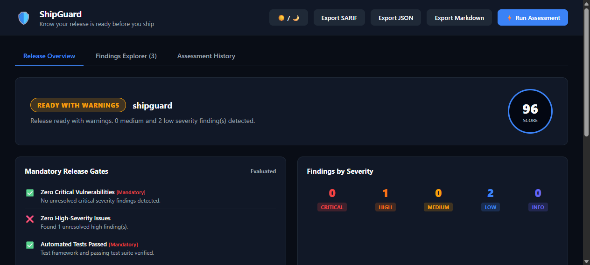

# ShipGuard

<p align="center">
  <strong>Software Release Readiness & Quality Checker — Know your release is ready before you ship.</strong>
</p>

<p align="center">
  
  
  
  
  
  
</p>

<p align="center">
  
</p>

---

## Repository Details

- **GitHub Repository:** [`https://github.com/0xyz-exe/shipguard`](https://github.com/0xyz-exe/shipguard)
- **Maintainer:** `0xyz-exe`
- **License:** Apache License 2.0
- **Default Branch:** `main`
- **Visibility:** Public

---

## Overview

**ShipGuard** is an open-source release readiness assessment platform that consolidates fragmented pre-deployment checks into a unified, deterministic quality gate.

Developers often rely on ad-hoc scripts or disconnected tools to determine if software is ready for production. Tests may pass while critical dependency vulnerabilities or hardcoded secrets remain unnoticed. ShipGuard provides a local-first, privacy-conscious analysis engine that evaluates your repository across 9 essential release dimensions before you ship.

### Core Principles

1. **Local-First & Offline:** Runs entirely on your development machine or CI runner without external API keys or cloud dependencies.
2. **Zero Secret Leakage:** Automatically recognizes and redacts AWS credentials, GitHub tokens, Slack keys, private keys, and database passwords before they can be logged or exported.
3. **Deterministic Scoring:** Category scores and overall readiness are calculated mathematically using transparent category weights, not opaque heuristics.
4. **Hard-Blocking Release Gates:** A numerical score of 95 will never bypass an unresolved critical security vulnerability or missing test suite.
5. **Standardized SARIF & CI Integration:** Exports native OASIS SARIF v2.1.0 for GitHub Code Scanning and automated pull request gates.
6. **Multi-Interface:** Run via the CLI, export machine-readable reports, or explore findings in the embedded real-time web dashboard.

---

## Quality Dimensions & Analyzers

ShipGuard evaluates projects across 7 weighted release categories using 9 modular analyzers:

| Category | Weight | Built-in Analyzers | Key Verifications |
| :--- | :---: | :--- | :--- |
| **Security** | 25% | `security` | Scans for AWS keys, GitHub PATs, private keys, API tokens, database URIs with passwords, and dangerous `eval()` execution. |
| **Testing & Coverage** | 20% | `testing-coverage` | Detects test runners (Vitest, Jest, Pytest, Cargo, PHPUnit), verifies test suites, and checks coverage artifacts. |
| **Code Quality** | 15% | `code-quality` | Checks for ESLint/Biome/Prettier configurations, unresolved `FIXME`/`BUG` markers, and stray `debugger;` statements. |
| **Build & Packaging** | 15% | `build-packaging` | Verifies build scripts, main entry point existence, distribution output, and Dockerfile health. |
| **Dependency Health** | 10% | `dependencies` | Verifies lockfiles, warns on conflicting lockfiles (`pnpm` + `yarn`), and detects wildcard version ranges. |
| **CI/CD Readiness** | 10% | `cicd-readiness` | Checks GitHub Actions workflows, automated CI testing, build steps, and flags risky `write-all` permissions. |
| **Documentation** | 5% | `project-metadata`, `documentation` | Validates package manifests, README, LICENSE, SECURITY.md, and CHANGELOG.md. |
| **Hygiene** | Auxiliary | `repo-hygiene` | Scans for committed `.env` files, `.gitignore` presence, large artifacts (>10MB), and OS junk files. |

---

## Quick Start

### 1. Installation

```bash
# Clone the repository
git clone https://github.com/0xyz-exe/shipguard.git
cd shipguard

# Install dependencies and build
pnpm install
pnpm run build
```

### 2. Run Release Assessment

```bash
# Analyze current project
node dist/cli.js analyze

# Analyze a specific repository with strict gates
node dist/cli.js analyze /path/to/repo --profile strict

# Launch the interactive browser dashboard
node dist/cli.js ui --port 4173
```

---

## Interactive Dashboard

ShipGuard includes a zero-dependency embedded HTTP server serving a developer console:

- **Decision Banner:** Immediate status indication (`READY`, `READY_WITH_WARNINGS`, `BLOCKED`, `INCOMPLETE`).
- **Gates Breakdown:** Checklist of mandatory vs. optional release gates with concrete failure reasons.
- **Category Progress Cards:** Visual score indicators with check counts and category weights.
- **Findings Explorer:** Filter by severity, category, or status (`OPEN`, `ACKNOWLEDGED`, `ACCEPTED_RISK`, `RESOLVED`) with actionable remediation guidance.
- **One-Click Export:** Download reports in SARIF v2.1.0, JSON, or Markdown formats directly from the browser.

---

## CLI Reference

```text
🛡️  ShipGuard — Software Release Readiness & Quality Checker
Know your release is ready before you ship.

USAGE:
  shipguard <command> [options]

COMMANDS:
  analyze [dir]          Run release readiness assessment (default)
  init                   Generate shipguard.config.json in project
  doctor                 Check analyzer system prerequisites and health
  report                 Print or export latest assessment report
  config validate        Validate project shipguard.config.json
  analyzers list         List all registered quality and security analyzers
  ui, web, serve         Launch interactive web dashboard
  version, -v            Show current version
  help, -h               Show this help message

OPTIONS:
  --project, -p <dir>    Target directory to inspect (default: .)
  --profile <name>       Readiness profile: production, strict, standard, lax
  --format, -f <fmt>     Output format: text, json, sarif, markdown (default: text)
  --output, -o <file>    Save report to destination file
  --port <num>           Port for web dashboard (default: 4173)
  --strict               Fail on warnings as well as blockers (exit code 1)
  --quiet, -q            Suppress banner output
```

### Exit Codes

| Code | State | Meaning |
| :---: | :--- | :--- |
| **`0`** | `READY` | All mandatory release gates passed without blocking failures. |
| **`1`** | `BLOCKED` | One or more mandatory release gates failed (or warnings detected with `--strict`). |
| **`2`** | `CONFIG_ERROR` | Missing target directory, invalid arguments, or schema validation failure. |
| **`3`** | `INTERNAL_ERROR` | Unexpected process exception or analyzer timeout. |

---

## Configuration (`shipguard.config.json`)

Configure project policies with schema validation:

```json
{
  "$schema": "https://raw.githubusercontent.com/0xyz-exe/shipguard/main/schemas/shipguard-config.schema.json",
  "version": 1,
  "profile": "production",
  "scoring": {
    "security": 25,
    "testing": 20,
    "code_quality": 15,
    "build": 15,
    "dependencies": 10,
    "cicd": 10,
    "documentation": 5,
    "hygiene": 0
  },
  "gates": {
    "failOnCritical": true,
    "failOnHigh": false,
    "requireTests": true,
    "requireBuild": true,
    "requireSecurityScan": true,
    "minimumScore": 80
  },
  "coverage": {
    "enabled": true,
    "minimumPercentage": 70
  },
  "exclusions": [
    "node_modules/**",
    "dist/**",
    "coverage/**",
    ".git/**"
  ]
}
```

---

## GitHub Actions CI Integration

Add ShipGuard to your GitHub Actions pipeline:

```yaml
name: Release Readiness

on:
  push:
    branches: [ main ]
  pull_request:
    branches: [ main ]

permissions:
  contents: read

jobs:
  shipguard:
    runs-on: ubuntu-latest
    steps:
      - uses: actions/checkout@v4
      - uses: actions/setup-node@v4
        with:
          node-version: 20
      - run: pnpm install
      - run: pnpm run build
      - name: Run ShipGuard
        run: node dist/cli.js analyze --format sarif --output report.sarif
```

---

## Automated Test Suite

ShipGuard is validated by unit and integration tests powered by Vitest:

```bash
# Run all automated tests
pnpm test

# Run TypeScript strict typecheck
pnpm run typecheck

# Rebuild distribution bundles
pnpm run build
```

---

## Documentation

- [Architecture Overview](docs/ARCHITECTURE.md)
- [Scoring Model & Weights](docs/SCORING.md)
- [Analyzers & Rule Index](docs/ANALYZERS.md)
- [CLI Reference Guide](docs/CLI.md)
- [Contributing Guide](CONTRIBUTING.md)
- [Security Policy](SECURITY.md)
- [Code of Conduct](CODE_OF_CONDUCT.md)
- [Changelog](CHANGELOG.md)

---

## License

ShipGuard is open-source software licensed under the [Apache License 2.0](LICENSE).
